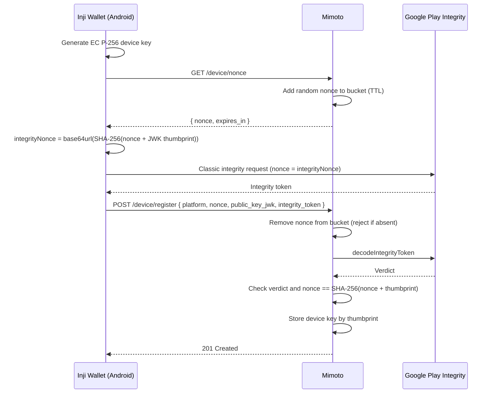
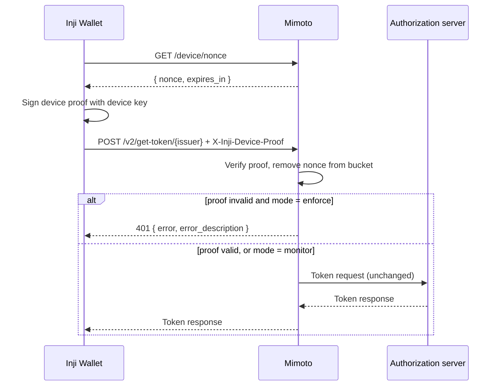

# Wallet Device Attestation for get-token

## Overview

`/get-token/{issuer}` and `/v2/get-token/{issuer}` are open endpoints. Device attestation lets mimoto serve them only to genuine Inji Wallet installs:

- **Register once per install.** The wallet proves with Google Play Integrity that it is a genuine Play-installed app on a genuine device, and registers a device public key.
- **Prove on every call.** Each get-token request carries a short-lived JWT signed by that device key. Play Integrity is not called again.

The flow is sessionless. Nonces live in a single-use bucket (Redis, or memory for single-instance setups), and the device public key is stored once, at registration.

Android (Play Integrity) is supported today. The registration API takes a `platform` so iOS App Attest can be added later.

## Key Features

- Play Integrity verdicts decoded on Google's servers, with package, signing certificate, device verdict, nonce and freshness checks
- Verdict bound to the device key, so a genuine device's verdict cannot be reused for another key
- Device proofs bound to the request method, path and body, and usable once
- Rollout modes: `off`, `monitor` (log only) and `enforce`

## Registration

**Integrity nonce.** `base64url(SHA-256(UTF-8(nonce + thumbprint)))`, unpadded, where `nonce` is the value from `/device/nonce` and `thumbprint` is the RFC 7638 SHA-256 JWK thumbprint (base64url, unpadded) of the key being registered. Both inputs are 43-character strings concatenated with no separator.

**Verdict checks.**

| Field | Requirement |
|---|---|
| `requestDetails.requestPackageName`, `appIntegrity.packageName` | Equal `android.package-name` |
| `requestDetails.nonce` | Equals the integrity nonce above |
| `requestDetails.timestampMillis` | Not older than `android.max-token-age-seconds`, not more than 60 s in the future |
| `appIntegrity.appRecognitionVerdict` | `PLAY_RECOGNIZED` |
| `appIntegrity.certificateSha256Digest` | Contains one of `android.cert-sha256-digests` |
| `deviceIntegrity.deviceRecognitionVerdict` | Contains one of `android.required-device-verdicts` |

Re-registering an active key refreshes its stored verdict. A `REVOKED` key stays revoked.

## Calling get-token

**Device proof** (header `X-Inji-Device-Proof`), a compact JWS:

| Part | Value |
|---|---|
| Header `alg` | `ES256` |
| Header `typ` | `device-proof+jwt` |
| Header `kid` | JWK thumbprint of the registered device key |
| `nonce` | Fresh value from `/device/nonce` |
| `htm` | `POST` |
| `htu` | The get-token URL. Only its path is compared, because mimoto runs behind an ingress; the single-use nonce from this mimoto's bucket prevents use against another server. |
| `iat`, `exp` | `exp` after `iat` and at most `proof-max-age-seconds` later. Not compared with mimoto's clock: the single-use nonce provides freshness, so device clock drift does not break proofs. |
| `req_hash` | `base64url(SHA-256(exact request body bytes))`, so the proof cannot be moved onto another request |

On `401 device_not_registered` (for example after mimoto's data was reset), the wallet should register again once and retry.

## API Reference

| Endpoint | Success | Errors |
|---|---|---|
| `GET /device/nonce` | `200 { nonce, expires_in }`, `Cache-Control: no-store` | |
| `POST /device/register` | `201`, no body | `400 invalid_request`, `400 invalid_nonce`, `400 attestation_failed`, `403 device_revoked`, `503 server_unavailable` |
| `POST /get-token/{issuer}`, `POST /v2/get-token/{issuer}` (enforce mode) | Unchanged | `401 invalid_device_proof`, `401 device_not_registered`, `401 device_revoked`, `413 invalid_request`, `503 server_unavailable` |

Errors use `{ "error": "<code>", "error_description": "<message>" }`.

## Configuration

Settings use the `wallet.device-attestation.*` prefix, not `mosip.inji.*`, because `/allProperties` publishes `mosip.inji.*` without authentication.

| Property | Default | Description |
|---|---|---|
| `mode` | `off` | `off`, `monitor` or `enforce` |
| `nonce-ttl-seconds` | `120` | Nonce lifetime, for registration and proofs |
| `proof-max-age-seconds` | `60` | Maximum device proof age |
| `android.package-name` | | Wallet application id |
| `android.cert-sha256-digests` | | App signing key SHA-256 from Play Console > App signing, as colon-separated hex or web-safe base64 |
| `android.allow-unrecognized-app` | `false` | Showcase only: accept `UNRECOGNIZED_VERSION` with a warning; nonce, package, certificate, freshness and device checks remain enforced. Keep false in production. |
| `android.required-device-verdicts` | `MEETS_DEVICE_INTEGRITY` | Accepted device verdicts |
| `android.max-token-age-seconds` | `300` | Maximum integrity token age at registration |
| `google.service-account-key-path` | | Service account key (JSON) for the Play Integrity decode API |

`/device/**` must be in `mosip.security.ignore-auth-urls` and `mosip.security.csrf-ignore-urls`.

**Nonce bucket.** With `spring.cache.type=redis`, nonces are stored in Redis under `injiweb:device-nonce:` and consumed with `GETDEL`, which needs Redis 6.2 or later. Otherwise they are kept in memory, which is only correct for a single mimoto instance.

## Setup

1. In Play Console, link the app to a Google Cloud project (App integrity > Play Integrity API) and note the project number for the wallet build.
2. In that Cloud project, create a service account, give mimoto its key file through a secret, and set `google.service-account-key-path`. Never commit the key.
3. Set `android.package-name` and `android.cert-sha256-digests`.
4. Rate-limit `/device/nonce` and `/device/register` at the ingress. Each registration calls Google, and classic requests are limited to 10,000 per app per day by default.
5. Roll out with `mode=monitor`, watch the `mimoto.device.proof` metric (tags `mode`, `outcome`), then switch to `enforce` once wallet builds that send proofs are adopted.

## Limitations

- **No key attestation.** The device key is not proven to be hardware-backed, so a key registered from one genuine device could be copied elsewhere. Revocation and rate limits are the mitigation.
- **Revocation is per key.** Reinstalling the app creates a new key and a new registration. Play Integrity device recall could carry a block across reinstalls in future.
- **iOS** is not supported yet; `enforce` blocks iOS wallets until App Attest is added.
- **Builds outside Play.** Only Play-distributed builds are `PLAY_RECOGNIZED`, so testing needs a Play testing track.
- **Orphaned rows.** Reinstalls leave unused rows; a cleanup by `last_seen_at` is planned.
